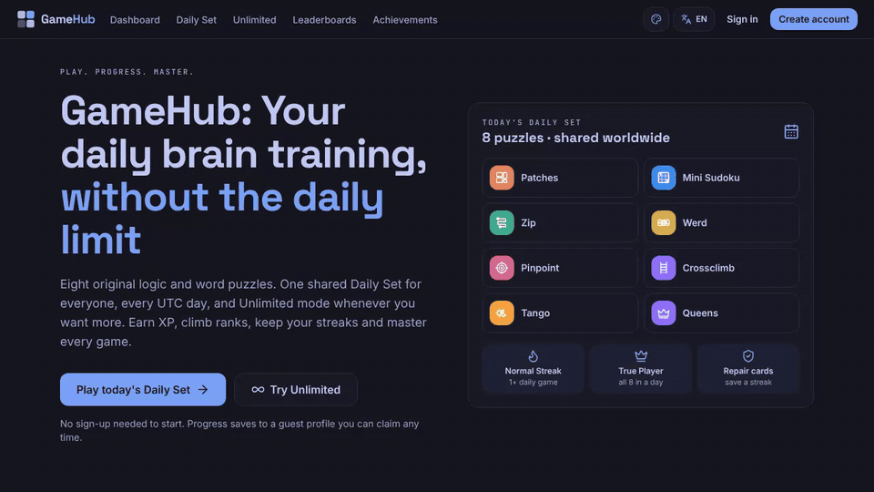
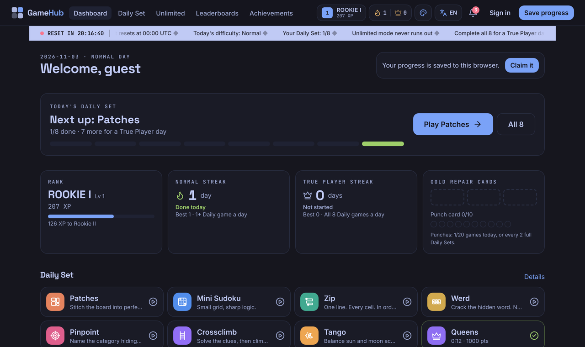
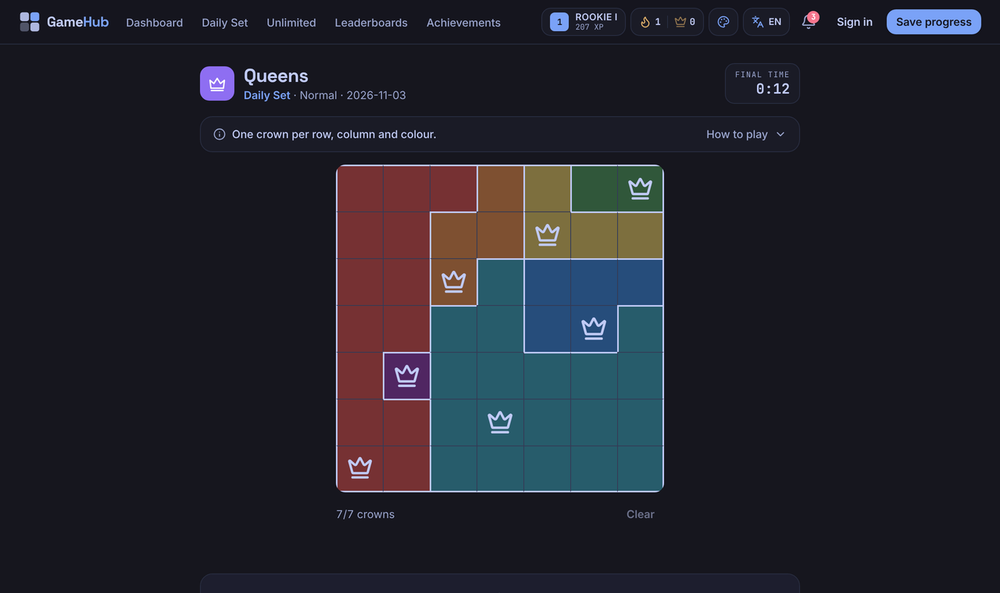
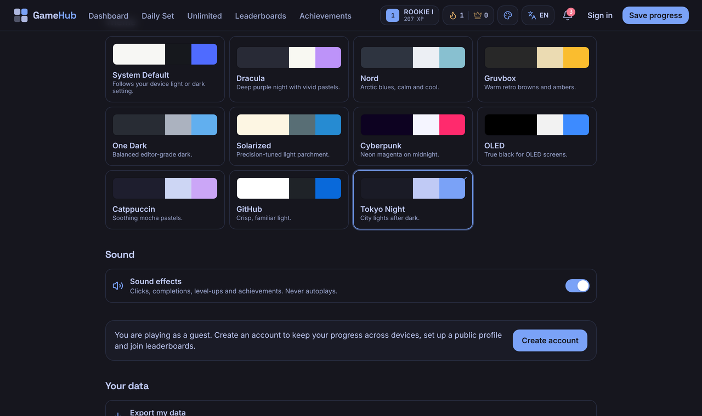
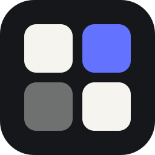

<div align="center">



<br />
<br />


<br />


<br />
<br />

**8 puzzle games · 1 shared Daily Set · Unlimited mode · 11 themes**

[Demo](#-see-it-in-action) · [Games](#-the-games) · [Features](#-features) · [Quick start](#-quick-start) · [Commands](#%EF%B8%8F-commands) · [Configuration](#%EF%B8%8F-configuration) · [Docs](#-documentation)

</div>

## 🎬 See it in action

<div align="center">
  
  <br />
  <sub>The running app: a Daily Queens solve, achievements unlocking, the dashboard and live theme switching.</sub>
</div>

## 🎮 The games

<div align="center">
  
</div>

## 📸 Screenshots

<table>
  <tr>
    <td width="50%"></td>
    <td width="50%"></td>
  </tr>
  <tr>
    <td align="center"><sub><b>Your dashboard</b></sub></td>
    <td align="center"><sub><b>A solved Queens puzzle</b></sub></td>
  </tr>
</table>

<div align="center">
  
  <br />
  <sub><b>All 11 themes</b></sub>
</div>

## ✨ Features

<table>
  <tr>
    <td width="33%" valign="top"><b>📅 Daily Set</b><br />A shared set of puzzles every UTC day.</td>
    <td width="33%" valign="top"><b>♾️ Unlimited mode</b><br />Keep playing after the Daily Set is done.</td>
    <td width="33%" valign="top"><b>🏆 Ranks and mastery</b><br />Earn XP, climb the ranks and master each game.</td>
  </tr>
  <tr>
    <td valign="top"><b>🔥 Two streaks</b><br />Protect them with Gold Streak Repair Cards.</td>
    <td valign="top"><b>🥇 Compete</b><br />Unlock achievements and climb the leaderboards.</td>
    <td valign="top"><b>🎨 11 themes</b><br />Pick the look that suits you.</td>
  </tr>
  <tr>
    <td valign="top"><b>🛡️ Server validated</b><br />Everything that matters is checked on the server.</td>
    <td valign="top"><b>🧰 Admin area</b><br />Built-in admin and moderator roles.</td>
    <td valign="top"><b>🌍 Languages</b><br />See <a href="docs/I18N.md"><code>docs/I18N.md</code></a>.</td>
  </tr>
</table>

## 🚀 Quick start

```bash
npm install
npm run dev            # http://localhost:3000
```

No database setup is needed locally. An embedded Postgres lives in `.data/pglite`, and migrations run automatically on the first request.

**Make yourself an admin:** sign up, stop the dev server, then run:

```bash
npm run admin:grant -- you@example.com admin
```

Or set `GAMEHUB_BOOTSTRAP_ADMINS=you@example.com` in `.env.local` before signing up.

## 🧱 Stack

| Layer | Tech |
|---|---|
| **App** | Next.js 16 (App Router), React 19, TypeScript |
| **Styling** | Tailwind CSS 4 |
| **Database** | PostgreSQL: Supabase in production, PGlite locally |
| **Testing** | Vitest, Playwright |

## ⌨️ Commands

| Command | What it does |
|---|---|
| `npm run dev` | Dev server (PGlite) |
| `npm run build` / `npm start` | Production build / server (`start` needs `DATABASE_URL`) |
| `npm test` | Unit + integration tests (Vitest, real Postgres via PGlite) |
| `npm run test:e2e` | Playwright journeys (run `npm run build` first) |
| `npm run lint` / `npm run typecheck` | ESLint / `tsc --noEmit` |
| `npm run check` | lint + typecheck + tests |
| `npm run db:migrate` | Apply migrations (`DATABASE_URL` or local PGlite) |
| `npm run admin:grant -- <email> [admin\|moderator] [--revoke]` | Manage roles |
| `npm run words:build` | Rebuild baked word lists (changes future puzzles) |

## ⚙️ Configuration

See `.env.example`. All game balance lives in `src/config/` and in each game's `config.ts`.

<details>
<summary><b>💰 XP economy, achievements and ranks</b></summary>

<br />

**XP economy: `src/config/economy.ts`.** Safe to edit any number there:

- `baseByDifficulty` (XP per game by difficulty)
- `gameMultiplier`
- `dailyMultiplier` (Daily vs Unlimited)
- `performanceBonus`, `perfectBonus`
- `unlimitedTaper` / `unlimitedFloor`
- `firstDailyGameBonus`, `dailySetCompleteBonus`
- `streakMilestones`
- `punchEarned`, `cardCreated`, `cardConverted`
- the repair-card rules in `REPAIR_CARDS`

Changes apply to future awards only; XP already earned stays in the ledger.

**Achievements:** the XP is the `xp` field of each entry in `src/config/achievements.ts`.

**Ranks:** thresholds are in `src/config/ranks.ts`. Ranks are recomputed from XP, so editing thresholds never changes anyone's XP.

</details>

Languages: see [`docs/I18N.md`](docs/I18N.md). Daily uniqueness: see [`docs/DAILY.md`](docs/DAILY.md).

## 📚 Documentation

Start with [`PROJECT_MASTER.md`](PROJECT_MASTER.md), then [`CURRENT_STATE.md`](CURRENT_STATE.md) and [`AI_HANDOFF.md`](AI_HANDOFF.md).

For details, see [`DECISIONS.md`](DECISIONS.md), [`FILE_MAP.md`](FILE_MAP.md) and [`docs/`](docs/).

---

<div align="center">
  
  <br />
  <sub><b>Play. Progress. Master.</b></sub>
  <br />
  <sub>Word lists: SCOWL (see <a href="THIRD_PARTY_NOTICES.md"><code>THIRD_PARTY_NOTICES.md</code></a>).</sub>
</div>
